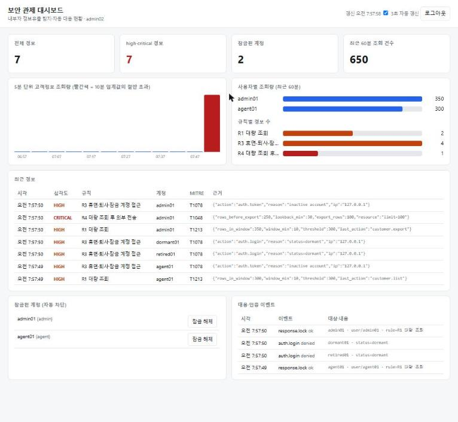
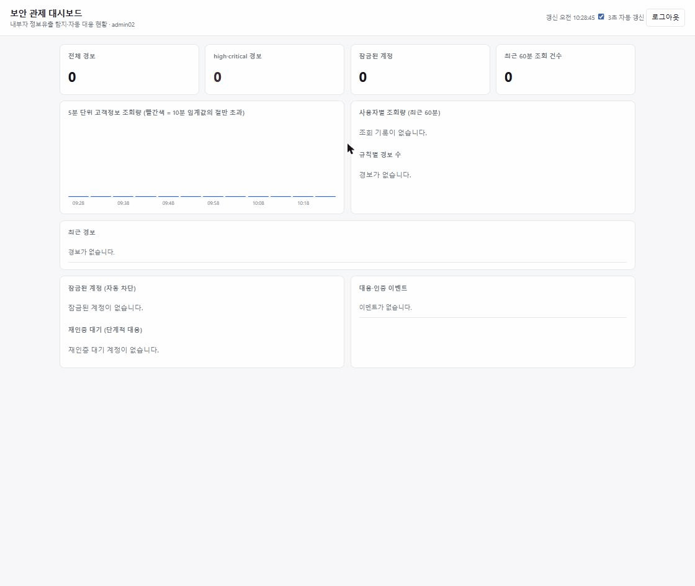
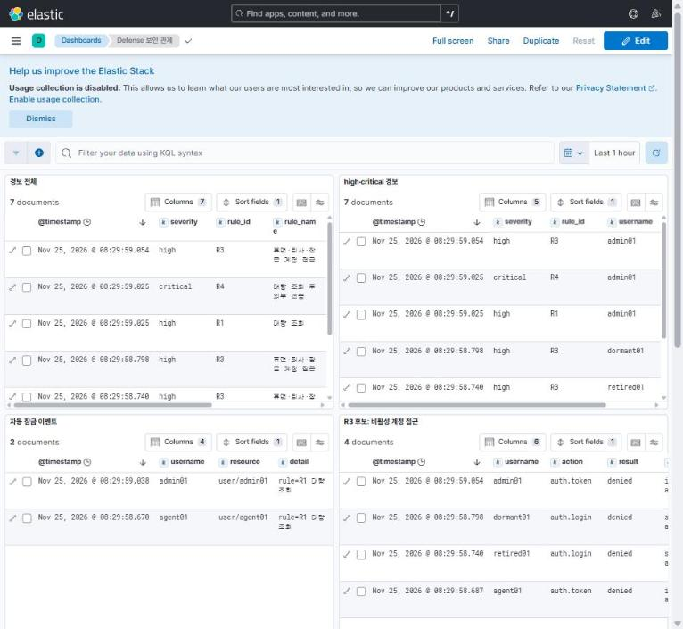

# Defense-follow: 내부자 정보유출 방어 모의 시스템

[](https://github.com/shk12170-dev/Defense-follow/actions/workflows/tests.yml)

쿠팡(2025.11, 내부 접근통제 미흡)과 롯데카드(2025.8, 탐지 지연) 개인정보 유출 사고의 교훈을 **로컬 가상 환경에서 재현하고, 방어 장치가 막는 과정과 한계를 수치로 측정**한 프로젝트입니다.

> 모든 데이터는 무작위 더미이며 로컬 실행 전용입니다. 공격 시뮬레이터는 정상 API를 정상 계정으로 호출해 대량 조회·반출 행동만 재현합니다.

| 정상 상태 | 공격 탐지·자동 차단 |
|---|---|
|  |  |

**시연 GIF** (대시보드 로그인 → 공격 시뮬레이션: 대량 조회는 **재인증 요구**, 반출은 **사전 차단** → 상담원이 인증 코드와 사유로 재인증하고 업무 재개, 3프레임):



## 핵심 결과 (방어 OFF → ON)
| 지표 | 방어 OFF | 방어 ON |
|---|---|---|
| 상담원 대량 조회로 확보한 건수 | 805건 (담당 고객 전부) | **300건**에서 차단 |
| 조회 후 반출된 건수 | 5,250건 | **250건** (내보내기는 실행 전에 거부) |
| 분당 10건 저속 공격 8시간 유출 | 4,800건 (탐지 못함) | **2,000건**에서 차단 |
| 첫 경보까지 | 경보 없음 | 약 80~100ms |
| 정상 요청 평균 응답 | 13.62ms | 13.86ms |

**2차 보완:** 1차 구현의 한계를 측정으로 확인한 뒤, ① 하루 누적 조회량 규칙(R5 경고 → R6 차단, 단계적 대응) ② 대량 조회 직후 내보내기 사전 차단(R7)을 추가했습니다. 1차에서는 첫 내보내기 1,000건이 유출된 뒤에야 계정이 잠겼고, 분당 30건 미만의 저속 공격은 탐지하지 못했습니다.

**3차 보완(구조적 한도):** 탐지만으로는 경보 전 유출과 저속 공격을 막을 수 없어서, ① 서버 **하드 쿼터**(반환 전 상한: 24시간 상담원 1,500·관리자 2,000건, 7일 상담원 7,000·관리자 8,000건) ② **허니토큰**(미끼 고객 접근 시 즉시 잠금) ③ **단계적 재인증**(TOTP+사유, 정상 업무 잠금 오탐 0.67% → 0건) ④ 범위 밖 ID 탐색 탐지(R11) ⑤ **내보내기 2인 승인**(옵션) ⑥ 주민번호 **암호화 저장**을 추가했습니다. 각 항목의 효과와 트레이드오프는 [보고서](docs/사고분석-대응보고서.md)에 있습니다.

**남은 한계:** 하루 1,200건 미만(분당 약 2.5건 이하)으로 천천히 빼가면 여전히 차단하지 못하고, 정상 업무에서도 계정 잠금 오탐 0.67%가 나옵니다. 임계값을 올리면 오탐은 줄지만 유출 건수가 늘어나는 트레이드오프도 정리했습니다. 자세한 내용은 [사고 분석·대응 보고서](docs/사고분석-대응보고서.md)와 [비교 결과](docs/benchmark.md)를 보세요.


## 구성
```
[공격 시뮬레이터] -> [FastAPI 고객정보 서비스 + SQLite(더미)]
                        |- JWT 인증 / RBAC / 마스킹 / 조회 상한
                        |- 감사 로그 (DB + JSON Lines, 해시 체인)
                        v
                   [탐지 엔진: YAML 규칙 R1~R8] -> [단계적 대응: 경고 / 잠금 / 반출 사전 차단] -> [대시보드]
```

| 규칙 | 설명 | 기본 기준 | 심각도 |
|---|---|---|---|
| R1 | 대량 조회 (쿠팡형) | 10분 내 300건 이상 | high (1차 재인증 요구 → 재인증 후 재발동 시 잠금) |
| R2 | 비정상 시간대 접근 | 00:00~05:59 KST | medium |
| R3 | 휴면·퇴사·잠금 계정 접근 | 비활성 계정의 로그인·토큰 사용 | high |
| R4 | 대량 조회 후 외부 전송 (롯데카드형) | 30분 내 200건 조회 후 내보내기 | critical |
| R5 | 일일 누적 조회 (1단계) | 24시간 누적 1,200건 이상 | medium (재인증 요구, 잠금 없음) |
| R6 | 일일 누적 조회 (차단, 2단계) | 24시간 누적 2,000건 이상 | high (잠금) |
| R7 | 대량 조회 직후 내보내기 사전 차단 | 직전 30분 200건 조회 후 내보내기 시도 | critical (반출만 막고 잠금 없음) |
| R12 | 로그인 실패 반복(스로틀) | 같은 아이디·IP에서 10분에 5회(IP 전체 20회) 실패하면 로그인을 일시 거부 | medium (계정은 잠그지 않음) |
| R11 | 범위 밖 고객 조회 거부 반복 | 담당이 아닌 고객 조회 거부가 10분에 10건 이상 (ID 순차 탐색) | high (재인증 요구 → 반복 시 잠금) |
| R10 | 허니토큰(미끼 고객) 접근 | 정상 업무로는 열 일이 없는 미끼 레코드에 접근 (전수·ID 순차 조회) | critical (즉시 잠금) |
| R9 | 조회 한도 초과 시도 | 서버 하드 쿼터(24시간·7일) 소진 후 시도 | high (이미 거부, 경고만) |
| R8 | 개인 기준선 대비 이상 조회량 (UEBA) | 오늘 누적이 본인 과거 평균의 4배 이상이고 500건 이상 | medium (재인증 요구) |

규칙은 [rules/rules.yaml](rules/rules.yaml)에서 조정하며, 규칙마다 MITRE ATT&CK 기법 번호를 붙였습니다.

### Sigma 규칙 (SIEM 간 이식용, [sigma/](sigma/))
R1~R7·R10은 Sigma 형식으로도 제공합니다(R8은 사용자별 과거 평균이 필요해 Sigma로 표현하지 않았습니다). 정확한 기준은 `rules/rules.yaml`이며, 합계(`rows`)를 셀 수 없는 Sigma의 한계 때문에 일부는 근사입니다.

| 규칙 | Sigma 파일 | 표현 | 검증 |
|---|---|---|---|
| R1 | defense_bulk_access_correlation.yml | 근사: 50건 이상 조회 6회/10분 | 구조 검증 |
| R2 | defense_offhours_data_access.yml | 정확 (`local_hour` 필드 필요) | 엔진과 탐지 결과 일치 확인 |
| R3 | defense_inactive_account_access.yml | 정확 | 엔진과 탐지 결과 일치 확인 |
| R4 | defense_bulk_then_export_correlation.yml | 근사: 대량 조회 후 30분 내 내보내기 | 구조 검증 |
| R5 | defense_daily_cumulative_correlation.yml | 근사: 50건 이상 조회 24회/24시간 (≈1,200건) | 50건 단위 조회에서 엔진 발동 시점과 일치 확인 |
| R6 | defense_daily_cumulative_correlation.yml | 근사: 50건 이상 조회 40회/24시간 (≈2,000건) | 50건 단위 조회에서 엔진 발동 시점과 일치 확인 |
| R7 | defense_export_preblock.yml | 정확: 차단 이벤트 하나로 매칭 | 엔진과 탐지 결과 일치 확인 |

pySigma(1.x/2.x)로 6개 파일 전부 쿼리 변환에 성공했습니다(`scripts/sigma_convert.py`, Splunk 백엔드). 다만 변환된 쿼리를 실제 SIEM에서 실행해 본 것은 아닙니다.

## 빠른 시작 (Windows PowerShell, Python 3.12)
```powershell
python -m venv .venv
.venv\Scripts\python -m pip install -r requirements.txt
.venv\Scripts\python scripts\seed.py                      # 더미 데이터 생성
.venv\Scripts\python -m uvicorn app.main:app --port 8000   # 서버 실행
```
- 대시보드: http://127.0.0.1:8000/dashboard (`admin01` 또는 `admin02`로 로그인)
- API 문서: http://127.0.0.1:8000/docs
- 비교 보고서: http://127.0.0.1:8000/report
- 테스트 계정: `agent01`~`agent05`, `admin01`, `admin02`, `dba01` (비밀번호는 `scripts/seed.py`의 `DEMO_PASSWORD`, 로컬 전용 더미 값)

## 시연 순서
1. 서버를 켜고 대시보드에 `admin02`로 로그인합니다 (정상 상태, 모든 수치 0).
2. 다른 터미널에서 공격을 실행합니다.
   ```powershell
   .venv\Scripts\python scripts\attack_sim.py
   ```
3. 대시보드가 3초 안에 갱신됩니다: 경보 → 계정 자동 잠금 → 이벤트 기록.
4. "잠금 해제" 버튼으로 오탐을 복구합니다. 이후 [대응 플레이북](docs/대응플레이북.md) 순서로 범위를 산정합니다.
5. 방어 OFF/ON 비교는 `scripts\benchmark.py`를 실행하면 `docs/`에 결과가 생성됩니다 (약 1~2분).

## API 요약
| 엔드포인트 | 권한 | 설명 |
|---|---|---|
| `POST /auth/login` | 전체 | 로그인(JWT) |
| `GET /customers` | agent, admin | 목록(마스킹, 최대 50건/요청) |
| `GET /customers/search?q=` | agent, admin | 이름·이메일 앞부분 검색(와일드카드 제외 2글자 이상) |
| `GET /customers/{id}` | agent(담당만), admin | 상세 (`unmask=true&reason=`은 admin만) |
| `GET /customers/export?limit=&reason=` | admin | 마스킹된 내보내기(사유 필수, 최대 1,000건). 직전 30분에 200건 이상 조회했다면 403으로 사전 차단 |
| `POST /auth/stepup` | 로그인 사용자 | 단계적 대응으로 재인증이 요구된 계정의 추가 인증(TOTP 코드 + 사유) |
| `POST /customers/export/request` · `GET /customers/export/{id}` | admin | 내보내기 승인 요청 · 승인 후 내려받기 (`DEFENSE_EXPORT_APPROVAL=on`일 때 직접 호출 대신 사용) |
| `GET /admin/export-requests` · `POST /admin/export-requests/{id}/approve\|reject` | admin | 승인 대기 목록, 다른 관리자의 승인·거절(본인 요청은 승인 불가) |
| `GET /audit` | admin | 감사 로그 조회 |
| `GET /alerts` | admin | 경보 조회 |
| `GET /stats` | admin | 대시보드 집계 |
| `POST /admin/users/{username}/unlock` | admin | 자동 잠금 해제 (휴면 계정은 불가) |

## ELK·Docker (선택)
`docker compose up --build`로 앱 + Elasticsearch + Kibana + Filebeat를 한 번에 실행합니다. 감사 로그와 경보를 Kibana에서 검색·시각화하고, 탐지 규칙은 [Sigma 형식](sigma/)으로도 제공합니다. 자세한 내용은 [docs/ELK.md](docs/ELK.md)를 보세요 (로컬 전용, 메모리 약 3GB 필요).



## 설계 포인트
- **최소 권한:** 상담원은 담당 고객만, DBA는 API 접근 불가, 마스킹 해제는 관리자 + 사유 필수
- **우회 차단:** 검색 와일드카드(`%%`)로 전수 조회하는 경로를 테스트 중 발견해 막음
- **매 요청 상태 재확인:** 토큰이 유효해도 DB의 계정 상태를 확인하므로 잠금이 즉시 적용
- **변조 탐지:** 감사 로그 해시 체인 (`scripts/verify_audit.py`)
- **저장형 XSS 방지:** 대시보드는 로그의 모든 값을 이스케이프해 표시 (공격자가 입력한 로그인 아이디로 확인)
- **구조적 한도:** 하드 쿼터는 탐지와 달리 데이터 반환 전에 적용되어 유출 상한이 고정됨 (`app/quota.py`)
- **미끼와 단계적 대응:** 허니토큰 접근은 즉시 잠금, 정상 업무와 겹칠 수 있는 규칙은 재인증 후 재발동 시 잠금
- **민감정보 암호화:** 주민번호는 `enc1:` 접두어의 Fernet 암호문으로 저장, 키는 `DEFENSE_DATA_KEY` (기본값은 모의 환경 전용)
- **외부 접근 보강:** 로그인 실패가 반복되면 (아이디, IP) 단위로 로그인을 일시 거부하고(HTTP 429) 계정은 잠그지 않아 남의 계정을 잠그는 공격을 피함. 재인증 코드(TOTP)는 한 번 쓰면 재사용 불가
- **방어 스위치:** `DEFENSE_MODE=off`로 탐지·자동 차단만 끄고 전후 비교

## 폴더 구조
```
app/          FastAPI 서비스, 탐지 엔진(detection.py), 자동 대응(response.py), 대시보드(static/)
rules/        탐지 규칙 (rules.yaml)
scripts/      seed.py, attack_sim.py, detect.py, benchmark.py, verify_audit.py, kibana_setup.py, docker_start.py, sigma_convert.py
elk/          Filebeat 설정
sigma/        Sigma 형식 탐지 규칙
tests/        pytest 155개 (test_day1~6, test_day8_elk, test_day9, test_day10_baseline)
docs/         보고서, 플레이북, 비교 결과, 스크린샷, 발표 자료(presentation.html), 작업일지
.github/      GitHub Actions (pytest 자동 실행)
기획서.md      프로젝트 기획서
```

## 테스트
```powershell
.venv\Scripts\python -m pytest -q
```

## 발표 자료
[docs/presentation.html](docs/presentation.html)은 10장짜리 발표 자료입니다(사고 → 구조 → 규칙 → 측정 결과 → 시연 → 보완 과정 → 3차 보완 → 한계 → 정리). 브라우저로 열어 ← → 키로 넘기고, F로 전체화면, Ctrl+P로 PDF 저장이 됩니다.

## 의존성 점검
`pip-audit`(임시 가상환경, 프로젝트 의존성 아님)로 `requirements.txt`를 점검한 결과 **PyJWT 2.10.1, starlette 0.41.3(FastAPI 경유), pytest 8.3.4에서 알려진 취약점이 다수 발견**되어 최신 버전(fastapi 0.165.0, PyJWT 2.15.1, pytest 9.2.0, uvicorn 0.54.0, PyYAML 6.0.4)으로 올렸습니다. 올린 뒤 155개 테스트가 모두 통과했고 재점검 결과 알려진 취약점이 없습니다(2026-11-26 기준). 점검 명령: `pip-audit -r requirements.txt`. 새 버전으로 Docker 이미지 빌드, 컨테이너 기동(healthy), 대시보드·로그인(200), Swagger 문서 표시까지 확인했습니다.

## 한계와 향후 과제
- 더 느린 공격: 하루 1,200건 미만은 고정 규칙으로 못 잡습니다. R8(개인 기준선)이 **평소 조회량이 적은 사용자**의 급증은 잡지만, 평소 하루 800건 넘게 보는 상담원은 4배가 R6보다 커서 효과가 없습니다 → 역할(동료 집단) 기준선은 측정 결과 효과가 없어 만들지 않았습니다(아래 보고서 5.3). 주간 누적은 과제
- 오탐: R1 잠금 오탐은 단계적 재인증(TOTP+사유)으로 0건이 됐지만(합성 로그 기준), 정상 사용자에게 재인증 마찰이 남고, 유효한 코드를 가진 내부자는 재인증을 통과할 수 있어 R1 기준 유출이 최대 약 2배(600건)까지 늘 수 있습니다. 하드 쿼터·R6가 상한입니다
- 조회 사전 차단: 내보내기는 사전 차단하지만, 조회는 R1 임계값(300건)까지는 확보할 수 있습니다
- Kibana 저장된 검색은 R1~R7·R9·R10, Sigma 규칙은 R1~R7·R10을 작성했습니다(R8은 Sigma 제외). 다만 Kibana의 R5·R6 패널은 실시간으로 재현하기 어려워(하루 누적이 필요) 합성 경보 레코드로만 동작을 확인했습니다 ([docs/ELK.md](docs/ELK.md) 참고)
- ELK·Docker Compose는 실제 기동까지 확인했습니다. Sigma 규칙은 pySigma 변환까지만 확인했고 SIEM 실행은 하지 않았습니다 ([docs/ELK.md](docs/ELK.md) 참고)
- 측정은 합성 로그와 단일 PC 인프로세스 기준이며, 실제 업무 패턴과 네트워크 지연은 반영하지 않았습니다.
