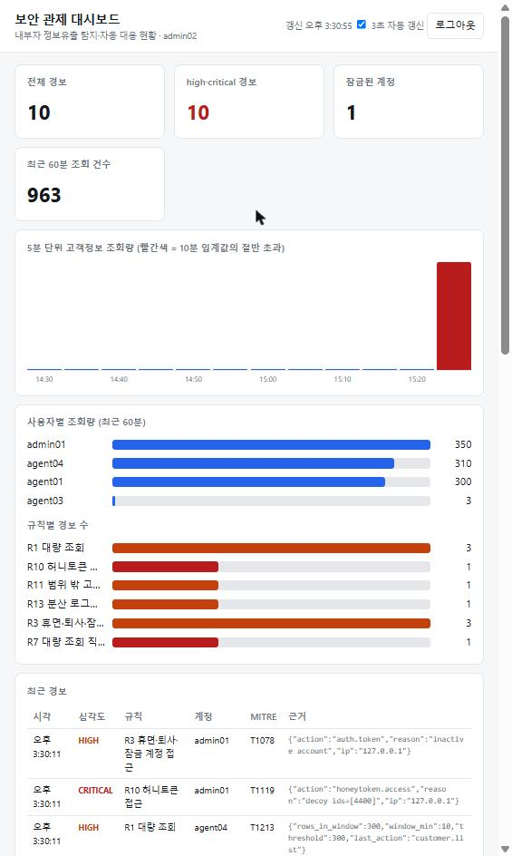
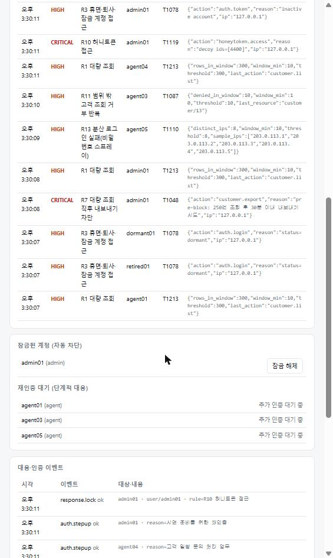

# 내부자 정보유출 사고 분석 및 대응 모의 보고서

> 대상: 쿠팡(2025.11) · 롯데카드(2025.8) 개인정보 유출 사고
> 방식: 로컬 가상 환경에서 사고 유형을 모의 재현하고 방어 장치의 효과를 측정
> 모든 데이터는 무작위 더미이며, 사고 관련 수치는 언론 보도 기준이라 공식 발표와 차이가 있을 수 있다.
> 저장소: github.com/shk12170-dev/Defense-follow

## 1. 개요

최근 3년간의 보안사고 가운데 **접근통제 미흡**(쿠팡형)과 **탐지·대응 지연**(롯데카드형)에 주목했다. 두 사고 모두 외부 해킹 기법 자체보다, 내부에서 데이터에 접근하는 방식을 통제·감시하지 못한 점이 피해를 키웠다는 공통점이 있다. 이 프로젝트는 두 문제를 하나의 시스템으로 묶어 모의 구현하고, 방어 장치가 있을 때와 없을 때의 피해 규모를 비교했다.

프로젝트의 질문은 하나였다. **"정상 권한으로 천천히 빼가는 내부자를, 어디까지 막을 수 있는가?"** 답은 "100%는 불가능하지만, 유출될 수 있는 최대량을 숫자로 못박아 크게 줄일 수 있다"이다. 아래 장은 구현, 측정, 한계를 순서대로 정리한다.

**최종 상태:** 탐지 규칙 14개, 공격 시나리오 6개, 자동 테스트 187개(GitHub Actions), 의존성 알려진 취약점 0건, Docker Compose로 앱과 ELK 기동, Sigma 규칙 9파일.

## 2. 사고 분석

| 구분 | 쿠팡 | 롯데카드 |
|---|---|---|
| 시기 | 2025.11 | 2025.8 |
| 규모 | 약 3,367만 계정 (이름·이메일 등) | 약 300만 명 |
| 핵심 문제 | 내부 통제·권한 관리 미흡이 주요 원인으로 지적됨 | 침해 발생 후 인지까지 17일 소요 |
| 제재(보도) | 과징금 규모는 출처별로 상이 (수백억~6천억 원대 보도) | 과태료 약 50억 원 |
| 교훈 | 최소 권한, 대량 조회 통제, 접근 기록 | 실시간 탐지, 신속한 격리, 대응 절차 |

*수치는 언론 보도 기준이다. 보고서나 발표에 인용할 때는 개인정보보호위원회 공식 발표로 확인해야 한다.*

## 3. 모의 시스템 설계

### 3.1 사고 교훈과 대응 기능의 매핑

| 교훈 | 구현 | 위치 |
|---|---|---|
| 최소 권한 | 역할별 접근통제(RBAC): 상담원은 담당 고객만, DBA는 API 접근 불가 | `app/security.py`, `app/main.py` |
| 민감정보 보호 | 기본 마스킹, 해제는 관리자만(사유 필수), 주민번호 암호화 저장 | `app/masking.py`, `app/crypto.py` |
| 대량 조회 방지 | 요청당 최대 50건, 검색어 2글자 이상, 내보내기 1,000건 상한, **서버 하드 쿼터** | `app/main.py`, `app/quota.py` |
| 접근 기록 | 감사 로그를 DB와 파일에 동시 기록, 해시 체인으로 변조 탐지 | `app/audit.py` |
| 실시간 탐지 | 규칙 14개(R1~R14), YAML로 임계값 조정, MITRE ATT&CK 매핑 | `app/detection.py`, `rules/rules.yaml` |
| 신속한 격리 | 단계적 대응: 재인증(TOTP) → 계정 잠금, 기존 토큰도 즉시 무효 | `app/response.py`, `app/totp.py` |
| 반출 차단 | 대량 조회 직후 내보내기를 실행 전에 거부, 내보내기 2인 승인(옵션) | `app/main.py` |
| 가시성 | 실시간 대시보드(경보·잠금·재인증 대기), Kibana, Sigma 규칙 | `app/static/dashboard.html`, `sigma/` |

### 3.2 탐지 규칙

| ID | 규칙 | 기본 기준 | 대응 |
|---|---|---|---|
| R1 | 대량 조회 | 10분 내 300건 이상 | 1차 재인증 요구, 재인증 후 다시 발동하면 잠금 |
| R2 | 비정상 시간대 접근 | 00:00~05:59 KST | 경고 |
| R3 | 휴면·퇴사·잠금 계정 접근 | 비활성 계정의 로그인·토큰 사용 | 잠금 |
| R4 | 대량 조회 후 외부 전송 | 30분 내 200건 조회 후 내보내기 | 잠금 |
| R5 | 일일 누적 조회 (1단계) | 24시간 누적 1,200건 이상 | 재인증 요구 |
| R6 | 일일 누적 조회 (차단) | 24시간 누적 2,000건 이상 | 잠금 |
| R7 | 반출 사전 차단 | 직전 30분 200건 조회 후 내보내기 시도 | 반출만 거부(403) |
| R8 | 개인 기준선 대비 이상 조회량 | 오늘 누적이 본인 과거 평균(최소 3일)의 4배 이상, 500건 이상 | 재인증 요구 |
| R9 | 조회 한도 초과 시도 | 서버 하드 쿼터를 소진한 뒤의 시도 | 경고(이미 거부됨) |
| R10 | 허니토큰 접근 | 미끼 고객 레코드가 응답에 포함됨 | 즉시 잠금 |
| R11 | 범위 밖 고객 조회 거부 반복 | 담당이 아닌 고객 조회 거부가 10분에 10건 | 재인증 요구, 반복 시 잠금 |
| R12 | 로그인 실패 반복 | 같은 아이디·IP 10분 5회, IP 전체 20회 실패 | 로그인 일시 거부(429), 계정은 잠그지 않음 |
| R13 | 분산 로그인 실패(스프레이) | 한 계정의 실패가 10분 안에 서로 다른 IP 8개 이상 | 재인증 요구, 계정은 잠그지 않음 |
| R14 | 다중 IP 동시 사용(토큰 탈취·계정 공유) | 한 계정의 조회가 10분 안에 서로 다른 IP 2개 이상에서 발생 | 재인증 요구, 계정은 잠그지 않음 |

R5~R8은 1차 측정에서 드러난 한계를 보완한 2차 규칙이고, R9~R14는 3차 보완(구조적 한도·외부 접근)과 추가 시나리오에서 만들었다. 정확한 기준은 `rules/rules.yaml`이다.

### 3.3 3차 보완: 탐지에서 구조적 한도로

탐지는 경보가 난 뒤에 대응하므로 그 사이 일부가 새고(R1 기준 최대 300건), 느린 공격은 임계값 아래로 빠져나간다. 그래서 반환하기 전에 상한을 거는 구조적 장치를 추가했다.

**① 서버 하드 쿼터 (`app/quota.py`).** 데이터를 **반환하기 전에** 최근 조회 건수를 합산해 상한을 강제한다. 24시간 기준 상담원 1,500건·관리자 2,000건, 7일 기준 상담원 7,000건·관리자 8,000건이며 가장 빡빡한 창이 적용된다. 남은 쿼터보다 많이 요청하면 남은 만큼만 내주고, 다 쓰면 HTTP 429로 거부하며 `blocked` 기록을 남긴다(R9). 합성 정상 업무 30일에서 상담원의 일일 조회량은 평균 740건·최대 1,202건, 7일 누적은 평균 5,118건·최대 6,118건이라 이 한도는 정상 업무를 막지 않았다.

**② 단계적 재인증 (`app/totp.py`).** 잠금 오탐은 정상 상담원의 업무를 멈춘다. 그래서 R1·R5·R8·R11·R13은 먼저 재인증을 요구한다. 계정은 잠그지 않지만 재인증 전까지 데이터 요청은 HTTP 428로 거부되고, 사용자는 인증 코드(TOTP, RFC 6238)와 사유(5자 이상)를 `POST /auth/stepup`에 제출하면 같은 토큰으로 업무를 이어간다. 코드를 10분 안에 3회 틀리면 잠기고, 한 번 쓴 코드는 재사용할 수 없다. R1은 재인증을 통과한 뒤 다시 기준을 넘으면(24시간 안) 잠근다. 이 결과 합성 정상 업무 30일에서 **계정 잠금 오탐이 1건(0.67%)에서 0건**이 됐다(1건은 재인증 요구로 바뀜).

- **트레이드오프:** 유효한 인증 코드를 가진 악의적 내부자는 재인증을 통과할 수 있어 R1 기준 유출이 최대 약 2배(300건 + 재인증 후 300건)까지 늘 수 있다. 그 위의 상한은 하드 쿼터와 R6가 만든다. 재인증은 탈취된 계정·토큰(코드 없음)에는 강하지만, 코드와 계정을 모두 가진 내부자에게는 책임 추적(사유 기록)과 마찰만 더한다.

**③ 허니토큰(미끼 고객).** 정상 업무로는 열 일이 없는 위치(전체의 뒤쪽 60% 구간, 담당 상담원 없음)에 가짜 고객 레코드를 심는다. 응답에 미끼가 포함되면 `honeytoken.access` 이벤트가 남고 R10이 계정을 즉시 잠근다. 정상 업무와 겹치지 않아 오탐이 거의 없다.

- **한계:** 미끼는 상담원 화면에는 나오지 않으므로 상담원이 자기 담당 목록만 읽는 유출에는 도움이 되지 않는다(이 경우는 R1·R5·R6·쿼터가 담당). 효과가 있는 경우는 상담원이 범위 밖 ID를 순차로 조회하다 미끼 ID를 건드릴 때, 관리자가 목록 뒤쪽 페이지로 건너뛰거나 전수 조회할 때다. 미끼 위치를 공격자가 알면 피할 수 있으므로 목록은 비밀로 관리해야 한다.

**④ 범위 밖 ID 탐색 탐지(R11).** 상담원이 고객 ID를 순차로 넣어 보면 대부분 "담당이 아님"으로 거부되는데, 이전에는 거부가 반복돼도 아무 규칙이 보지 않았다. 10분에 10건 이상 거부되면 재인증을 요구하고 반복하면 잠근다. 위험 점수(여러 약한 신호의 가중 합산)는 가중치를 정할 라벨 데이터가 없어 임의 값이 되므로 만들지 않았다.

**⑤ 내보내기 2인 승인(옵션, `DEFENSE_EXPORT_APPROVAL=on`).** 켜면 내보내기를 직접 호출할 수 없고, 관리자가 요청(사유 필수)을 올리면 **다른 관리자**가 승인해야 한다(본인 요청은 승인 불가). 승인 후 15분 안에 요청자만 한 번 내려받을 수 있고, 내려받을 때도 반출 사전 차단(R7)과 하드 쿼터를 다시 거친다. 기본은 꺼져 있다. 한 PC의 모의 환경에서는 승인자도 같은 사람일 수 있어 조직적 분리는 검증할 수 없고, "요청자 ≠ 승인자"와 일회성·만료만 기술적으로 검증했다.

**⑥ 민감정보 암호화 저장(`app/crypto.py`).** 주민번호를 Fernet(AES-128-CBC+HMAC)으로 암호화해 `enc1:` 접두어로 저장한다. DB 파일이 통째로 유출돼도 키 없이는 평문이 없고, 복호화는 마스킹된 응답과 관리자의 마스킹 해제에서만 일어난다. 키가 틀리면 빈 값을 돌려줘 평문이 새지 않는다(안전 쪽 실패).

- **한계:** 앱 프로세스가 복호화 키를 가지므로 앱 권한을 탈취한 공격자에게는 소용이 없고, 키는 실제로는 KMS 등에 보관해야 한다. 전화번호·주소 등 다른 필드는 암호화하지 않았다.

### 3.4 유출 상한을 더 줄이기 위한 쿼터 강화 (4종)

3차 보완의 하드 쿼터는 한도를 정상 업무 최대치 바로 위에 잡았기 때문에 유출 상한도 컸다(상담원 일 1,500건, 10분 300건). 합성 정상 업무 30일을 유형별로 보면 **상세·검색은 하루 최대 약 390건·10분 최대 33건**에 그치고, 큰 숫자를 만드는 것은 목록 페이지 넘기기(일 평균 457건·최대 880건, 10분 최대 300건)다. 그래서 다음 4가지를 구현했다(`app/quota.py`, `rules/rules.yaml`).

1. **조회 유형별 일일 한도:** 상세·검색(상담원·관리자 500건/일), 목록(900건/일)을 따로 센다. 한 유형을 다 써도 다른 유형은 별도로 계산된다.
2. **10분 하드 쿼터:** 상세·검색 100건/10분(정상 최대 33건이라 오탐 없음), 목록 200건/10분. 경보를 기다리지 않고 반환 전에 거부하므로 R1(300건)이 발동하기 전에 한 구간이 덜 샌다. 관리자 조회에도 같은 한도를 적용한다.
3. **재인증 통과 후 한도 50% 축소:** 본인 인증 코드를 가진 내부자는 재인증을 통과할 수 있으므로, 통과 후 24시간은 모든 한도를 절반으로 줄여 재인증만으로 한도를 되찾지 못하게 한다.
4. **마스킹 해제(unmask) 별도 한도:** 원본이 나가는 경로라 관리자 하루 20건으로 따로 제한한다(마스킹된 일반 조회에는 영향 없음).

한도 값은 **프로필**로 묶었다(`DEFENSE_QUOTA_PROFILE`, 기본 `standard`). `standard`는 상담원이 목록을 하루 평균 457건 넘겨 본다는 가정에서도 오탐이 적은 값이고, `strict`는 유출 상한을 크게 줄이지만 목록 열람이 잦은 업무를 막는다. 두 프로필과 이전 설정을 같은 합성 로그로 측정한 결과는 다음과 같다(`scripts/quota_study.py`, 서버와 같은 계산을 메모리에서 재생).

| 설정 | 정상 업무 오탐(한도에 걸린 상담원·일) | S1 상담원 대량 조회 | S4 관리자 조회 | 공격자 하루 최대 | 재인증 후 하루 | 14일 × 하루 1,450건 |
|---|---|---|---|---|---|---|
| 이전 (24시간·7일 합계 한도만) | 0/150일 (0%) | 1,500건 | 2,000건 | 1,500건 | 1,500건 | 14,000건 |
| **표준 프로필(기본)** | 8/150일 (5.3%) | **200건** | **200건** | **1,400건** | **700건** | 14,000건 |
| 엄격 프로필 | 143/150일 (95.3%) | 100건 | 100건 | 800건 | 400건 | 7,000건 |
| 엄격 프로필, 목록 열람 없는 업무 | 0/150일 (0%) | 100건 | 100건 | 800건 | 400건 | 7,000건 |

*S1·S4 열은 한 유형만 쉬지 않고 요청할 때 한도에 걸릴 때까지의 유출 건수다. "공격자 하루 최대"는 한도 사이를 번갈아 가며 가져가는 최악의 경우다. 정상 업무 오탐은 한도에 걸린 요청이 하루에 한 번이라도 있었던 상담원·일의 비율이다. 마지막 행은 목록 조회 이벤트를 제거한 업무(상세·검색만)로 재생한 값이다.*

**해석과 한계**

- **오탐 없이 줄일 수 있는 것은 제한적이다.** 상세·검색 한도만 걸면 정상 업무가 막히는 날이 없다(0/150일). 오탐은 거의 전부 목록 한도에서 나온다. 표준 프로필은 오탐 5.3%를 받아들이는 대신 S1 -33%, 재인증 후 -53%를 얻는다. 일일 최대(1,500 → 1,400)와 14일 누적은 거의 줄지 않는다.
- **유출 상한을 대폭 줄이려면 업무 방식이 바뀌어야 한다.** 엄격 프로필은 유출 상한을 S1 -67%, 하루 -47%, 재인증 후 -73%, 14일 누적 -50%로 줄이지만, 합성 상담원이 목록을 자주 넘겨 보는 업무에서는 95%의 날에 막힌다. 반대로 목록 열람을 하지 않는 업무(상세·검색만)에서는 오탐이 0이다. 즉 오탐은 한도 숫자가 아니라 "목록 열람이라는 업무 방식"의 비용이다. 목록 열람을 필터·검색 중심으로 바꾼 뒤에 엄격 프로필을 쓰는 것이 맞다.
- **전제의 한계:** 합성 정상 업무에서 상담원이 목록을 넘겨 보는 양(일 평균 457건)은 이 프로젝트가 정한 가정이고, 실제 업무가 다르면 오탐률도 달라진다. "목록 열람 없는 업무" 열은 목록 이벤트를 제거한 단순화이며, 그 일을 검색·상세가 대신하는 양이 로그보다 더 크면 오탐이 생길 수 있다.
- **성능:** 요청마다 한도별 합산이 필요해 쿼리를 한 번으로 합쳤다. 정상 요청 평균 응답은 약 15.3ms에서 16.1ms(약 +5%)로 늘었다.
- 서로 다른 고객 수 기준 쿼터, 업무 연계 접근(처리 중인 상담 건만 조회), 담당 고객 수 축소는 실제 업무 로그·시스템이 있어야 정할 수 있어 구현하지 않았다.

### 3.5 외부 접근 보강과 시나리오 5

스스로 점검해 보니 (1) 로그인 실패를 반복해도 막는 장치가 없어 비밀번호 대입에 열려 있었고, (2) 재인증 코드(TOTP)를 한 번 쓰고 난 뒤에도 90초 안에는 재사용할 수 있었다.

- **로그인 스로틀(R12):** 같은 (아이디, IP)에서 10분에 5회, 같은 IP에서 20회 실패하면 그 조합의 로그인을 10분간 거부(HTTP 429)한다. 비밀번호 검증 전에 판단해 아이디 존재 여부와 무관하게 같은 응답을 주고, **계정은 잠그지 않는다**(공격자가 남의 계정에 일부러 실패해 정상 사용자를 막는 것을 피하기 위해 아이디와 IP 조합 단위로 제한).
- **TOTP 재사용 방지:** 사용한 구간 번호를 기록해 같은 코드나 더 이전 구간 코드를 거부한다.

**시나리오 5: 분산 IP 비밀번호 스프레이(R13).** 스로틀의 한계로 적어 둔 "IP를 바꾸는 분산 대입"을 시나리오와 규칙으로 만들었다. 공격자가 12개 IP에서 한 계정에 각 1회씩 시도하면 (아이디, IP) 단위로는 5회 기준 아래라 R12를 피한다. 그래서 **계정 기준으로 서로 다른 IP 수**를 세는 R13(10분에 8개 IP 이상)을 추가했다. R13은 계정을 잠그지 않고 **재인증을 요구**한다. 그 결과 공격자가 결국 올바른 비밀번호를 알아내 로그인에 성공해도 인증 코드(TOTP) 없이는 데이터에 접근할 수 없다.

- **실행 결과:** 12개 IP 모두 401 → 올바른 비밀번호 로그인 200 → 데이터 조회 428. 대시보드에서 R13 경보와 재인증 대기 계정이 표시됨을 Chrome에서 확인했다.
- **전제:** 서버가 프록시 뒤에서 실제 클라이언트 IP를 알아야 하므로 `DEFENSE_TRUSTED_PROXY=on`(X-Forwarded-For의 첫 주소 사용)을 추가했다. 기본은 꺼져 있고, 신뢰할 수 있는 프록시 없이 켜면 누구나 IP를 위조해 스로틀과 탐지를 피할 수 있다(테스트로 확인).
- **한계:** 이 PC에서는 X-Forwarded-For로 여러 IP를 흉내 냈을 뿐 실제 분산 공격이 아니다. 한 IP가 여러 계정을 시도하는 경우는 R12의 IP 단위 한도가 담당한다. 공격자가 TOTP까지 가지고 있다면 재인증도 통과할 수 있다.

**시나리오 6: 로그인 토큰 탈취 후 다른 IP에서 사용(R14).** 로그인에 성공한 계정의 토큰이 유출되어 공격자가 다른 곳에서 쓰는 경우다. 비밀번호도 맞고 토큰도 유효해서 지금까지의 규칙(대량 조회, 로그인 실패 등)으로는 구분되지 않고, 공격자가 천천히 읽으면 쿼터 안에서 움직일 수도 있다. 단서는 **한 계정이 짧은 시간에 서로 다른 IP에서 조회한다**는 점이다. R14가 이를 감지(10분에 IP 2개 이상)하면 계정을 잠그지 않고 **재인증(TOTP)을 요구**한다. 토큰만 가진 공격자는 인증 코드가 없어 이후 요청이 모두 428로 막힌다.

- **실행 결과:** 정상 사용자 IP에서 조회 200 → 탈취한 토큰으로 다른 IP에서 첫 요청 50건 확보 → 두 번째 요청부터 428(차단). 대시보드에 R14 경보와 재인증 대기 계정이 표시됨을 Chrome에서 확인했다(`screenshots/09-scenario6-r14.jpg`).
- **한계 1(첫 요청은 샌다):** 두 번째 IP의 첫 요청은 경보가 난 뒤에야 막히므로 그 한 번(최대 한 페이지)은 나간다.
- **한계 2(정상 사용자도 막힌다):** 대응이 계정 단위라 같은 계정의 정상 사용자도 재인증 전까지 428을 받는다. 잠그지 않고 재인증만 요구하는 이유는 정상 사용자가 Wi-Fi와 모바일을 오갈 때도 걸릴 수 있기 때문이다(오탐 비용을 재인증 한 번으로 제한).
- **한계 3(오탐은 가정으로만 측정):** 합성 정상 업무 로그는 접속 IP가 하나뿐이라, 정상 사용자가 네트워크를 바꾸는 경우(Wi-Fi→핫스팟)를 가정해 넣어 측정했다(`scripts/r14_study.py`, 결과 `docs/r14_study.md`). 전환 빈도는 실측이 아니라 가정이다. 창 10분 기준 오탐은 전환이 하루 5%일 때 상담원-일의 6.7%, 20%일 때 20.7%였다. 창을 5분으로 줄이면 오탐은 비슷하고(4.0%·20.0%), 정상 사용자 마지막 요청 후 10분 뒤에 쓰는 탈취는 놓친다. 창 2분은 오탐이 0.7%·8.7%로 줄지만 5분 뒤 탈취도 놓친다. 그래서 창 10분을 유지하되, 실제 업무 로그의 IP 전환 빈도로 다시 정해야 한다. 같은 NAT 뒤의 두 공격자나 VPN을 쓰는 공격자는 구분하지 못한다.
- **전제:** 시나리오 5와 같이 서버가 실제 클라이언트 IP를 알아야 하므로 `DEFENSE_TRUSTED_PROXY=on`이 필요하다(시뮬레이션은 `X-Forwarded-For`로 IP를 흉내 냄).

### 3.6 검증 상태

| 항목 | 방법 | 결과 |
|---|---|---|
| 자동 테스트 | pytest, GitHub Actions | 187개 통과 |
| 의존성 취약점 | pip-audit (주간 워크플로 포함) | PyJWT·starlette·pytest의 알려진 취약점을 발견해 최신 버전으로 상향, 재점검 0건 |
| Docker 이미지 | 새 버전으로 빌드·기동 | healthy, 대시보드·로그인 200 |
| ELK 연동 | Docker Compose 실제 기동, Kibana 저장된 검색 14개 | 감사 로그·경보 적재와 검색 확인 (R9 검색은 실제 데이터로 확인 못 함) |
| Sigma 변환 | pySigma로 9개 파일 변환 | 실패 0건 (Splunk 백엔드, 단일 이벤트는 Lucene도) |
| Sigma 실행 | 단일 이벤트 규칙(R3·R7·R10)을 실제 Elasticsearch에서 실행해 엔진 경보와 건수 비교 | 3/3, 1/1, 1/1 일치 (R2는 새벽 데이터가 없어 합성 문서 1건으로 쿼리 동작만 확인) |

## 4. 모의 실험 결과 (더미 고객 4,000건, 단일 PC)

`docs/benchmark.html`(서버 실행 후 `/report`)에 전체 표가 있다. RBAC·마스킹·조회 상한은 두 모드 모두 켜 두고, **실시간 탐지, 자동 대응, 반출 사전 차단, 쿼터만** 껐다 켰다.

| 지표 | 방어 OFF | 방어 ON |
|---|---|---|
| 시나리오 1: 상담원 대량 조회로 확보한 건수 | 약 800건 (담당 고객 전부) | **200건**에서 차단 (5번째 요청, 표준 쿼터 프로필) |
| 시나리오 4: 조회 후 반출된 건수 | 5,250건 (내보내기 5회 성공) | **200건** (내보내기는 실행 전에 거부) |
| 첫 경보까지 걸린 시간 | 경보 없음 | 약 80~110ms |
| 정상 요청 평균 응답 시간 | 15.3ms | 16.1ms (약 +5%) |

*그림 1. 시나리오 1·3·4·5와 시연 이벤트를 실행한 직후의 대시보드(현재 동작). 왼쪽: 경보·조회량·규칙별 경보 수(R1·R3·R7·R10·R11·R13). 오른쪽: 허니토큰(R10)으로 잠긴 계정 admin01, 재인증 대기 중인 agent01·agent03·agent05(R1·R11·R13), 재인증 통과 이벤트*

### 4.1 단계별 개선 비교

| 항목 | 1차 구현 | 2차 보완 | 3차(표준 프로필) | 엄격 프로필(선택) |
|---|---|---|---|---|
| 시나리오 1: 상담원 대량 조회로 확보한 건수 | 약 800건 → 300건 | 300건 | **200건** | 100건 |
| 시나리오 4: 반출 전 조회로 새는 건수 | 1,250건 | 250건 | **200건** | 100건 |
| 시나리오 4: 성공한 내보내기 | 1회 (1,000건 유출 후 잠금) | 0회 | 0회 | 0회 |
| 분당 10건 저속 공격 8시간 | 4,800건 (차단 못함) | 2,000건에서 차단(R6) | 1,400건 상한(유형별 쿼터) | 800건 상한 |
| 재인증을 통과한 뒤 하루 최대 | 해당 없음 | 해당 없음 | **700건** | 400건 |
| 하루 1,450건씩 14일 | 미측정 | 20,300건 (쿼터 없음) | 14,000건 | **7,000건** |
| 정상 업무 계정 잠금 오탐 (150 상담원·일) | 1건 (0.67%) | 1건 (0.67%) | **0건** (재인증 요구 1건) | 0건 |
| 정상 업무가 한도에 걸린 날 | 해당 없음 | 해당 없음 | 8/150일 (5.3%) | 143/150일 (목록 열람 없는 업무는 0) |
| 분산 IP 비밀번호 스프레이 | 미탐지 | 미탐지 | R13 탐지, 재인증 전 데이터 접근 불가 | 동일 |
| 의존성 알려진 취약점 | 미점검 | 미점검 | 0건 | 0건 |

롯데카드 사고에서 침해 인지까지 17일이 걸렸다는 보도와 비교하면, 모의 시스템의 경보는 문제가 된 요청 안에서 발생한다. 단, 이는 구조적 차이를 보여 주는 참고 비교이며 실제 환경의 성능 보장이 아니다.

## 5. 한계와 개선 방향

### 5.1 측정에서 얻은 설계 판단

- **경고 임계값은 측정 후 정했다.** R5를 1,000건으로 두면 정상 업무에서 경고가 31건(상담원·일의 21%)으로 너무 잦아 알림 피로가 우려됐다. 1,200건으로 올리자 경고가 7건으로 줄었고 저속 공격 유출 건수는 그대로였다.
- **차단 임계값은 오탐과 유출의 균형이다.** R1 임계값을 400건으로 올리면 정상 업무 차단 오탐은 사라지지만 공격 시 유출 건수가 300건에서 400건으로 늘어난다.
- **측정이 잡아낸 보안 버그.** 검색어 `%%`가 와일드카드 제거 후 빈 검색어가 되어 전체 고객이 조회됐다. 2글자 이상을 요구하도록 고치고 회귀 테스트를 추가했다.
- **구현하지 않기로 판단한 것.** 역할(동료 집단) 기준선은 상담원 일일 조회량이 평균 740건·표준편차 166건이라 `평균+3σ`가 약 1,240건으로 R5와 사실상 같아 새로 잡는 공격이 없었다. 개인 기준선(R8)은 평소 조회량이 적은 사용자에게만 효과가 있고, 하루 800건 넘게 보는 상담원에는 효과가 없다.

### 5.2 남은 한계

1. **아주 느린 공격은 완전히 막지 못한다.** 쿼터로 일일(표준 1,400건, 엄격 800건)·7일(7,000건·3,500건) 상한은 고정됐지만, 그 한도 미만으로 가져가는 양은 정상 업무량과 구분되지 않는다. 한도를 더 낮추려면 목록 열람 같은 업무 방식을 바꿔야 한다(3.4절). 월간 쿼터나 업무일 캘린더는 실제 업무 로그가 있어야 정할 수 있다.
2. **오탐은 완화했으나 남아 있다.** 합성 로그 기준 계정 잠금 오탐은 0건이지만 정상 사용자에게 재인증 마찰이 남는다. 실제 업무 로그로 임계값 조정이 필요하다.
3. **조회는 사전 차단하지 못한다.** 조회 경보는 요청 처리 시점에 발생하므로 R1 기준 재인증 전 최대 약 300건은 확보할 수 있다. 조회를 직전 30분 200건 미만으로 나눠 읽은 뒤 내보내면 R7을 피할 수 있다(일일 누적 규칙과 쿼터가 보완).
4. **재인증은 코드를 가진 내부자를 막지 못한다.** 유효한 TOTP를 가진 악의적 내부자는 통과할 수 있다. 책임 추적과 마찰을 더할 뿐이다.
5. **검증 범위의 한계.** 상관 규칙(R1·R4·R5·R6)의 Sigma 쿼리와 Splunk 변환 쿼리는 실제 SIEM에서 실행하지 못했다. R2는 서버 시계를 바꿀 수 없어 합성 이벤트로 검증했다. 측정은 합성 로그와 단일 PC 인프로세스 기준이라 실제 업무 패턴과 네트워크 지연은 반영되지 않는다.
6. **범위 밖.** 외부 침입 방어(WAF, 네트워크 분리, 실제 MFA 연동, 분산 환경의 IP 관리)는 이 PC 한 대로 의미 있게 검증할 수 없어 다루지 않았다.

## 6. 결론

접근통제와 마스킹만으로는 "정상 권한으로 천천히 빼가는" 내부자를 막을 수 없고, 반대로 사후 탐지만으로는 첫 피해를 막지 못한다. 이 프로젝트는 두 계층을 함께 두고, **측정 결과를 보고 규칙을 보완하는 순환**(구현 → 측정 → 한계 발견 → 보완 → 재측정)을 세 차례 거쳤다.

그 결과 반출은 사전에 막고(1,250건에서 200건), 저속 공격은 반환 전 쿼터로 유출 상한을 고정했으며(미탐에서 하루 1,400건, 엄격 프로필 800건 상한), 정상 업무의 계정 잠금 오탐은 재인증으로 0건이 됐다. 유출 상한을 더 줄이는 쿼터 강화는 오탐과 맞바꾸는 관계임을 측정으로 확인했다(표준 5.3%, 엄격 95.3%, 목록 열람 없는 업무 0%). 분산 비밀번호 대입은 계정을 잠그지 않고 재인증을 요구하는 방식으로 대응했다. 불리한 수치(재인증을 통과하는 내부자, 쿼터 미만의 다일 누적, 실행하지 못한 SIEM 검증)를 숨기지 않고 한계로 남긴 것이 이 결과의 신뢰도를 뒷받침한다.

실제 운영으로 가려면 실로그 기반 임계값 튜닝, 상관 규칙의 SIEM 실행 검증, 외부 침입 방어 연계, 대응 절차(`docs/대응플레이북.md`)가 다음 단계다.
